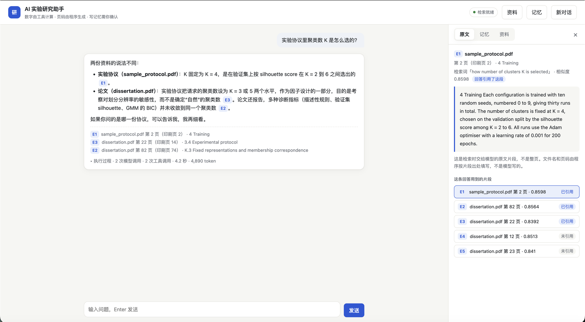
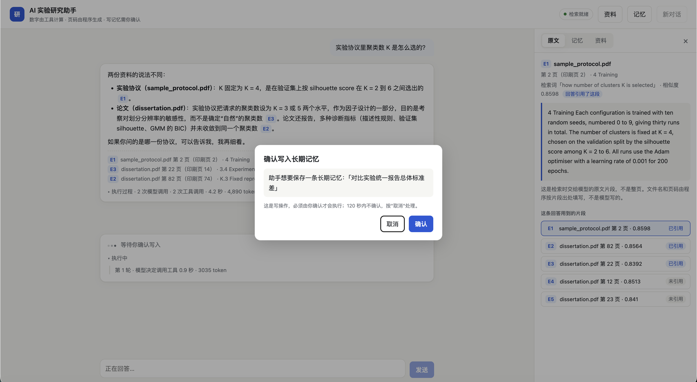
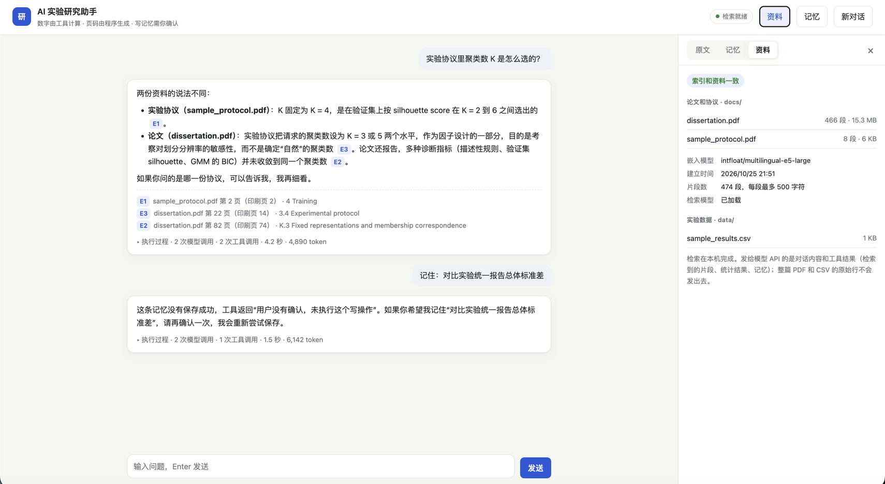

# research-assistant — AI 实验研究助手

逐阶段搭建的学习项目：一个研究助手（命令行和本地网页），能检索论文原文并带页码引用作答、统计实验结果 CSV、在用户确认后保存长期记忆。

**当前进度：阶段 5 完成 —— 单 Agent + 工具调用 + 多轮会话 + SQLite 长期记忆 + 受限 CSV 统计 + 本地向量检索（RAG）+ 证据编号引用 + JSONL 运行日志 + 端到端评估 + 本地网页界面。**



## 当前能做什么

- **检索论文并引用来源**：模型调用 `search_documents`，在本地向量索引里检索相关段落（默认前 3 个）。程序给每个段落分配证据编号（E1、E2…，整段对话内不重复），模型在回答里写 `[E1]`，程序据此在回答末尾补上"文件 · 页码 · 章节"。模型写了检索结果里不存在的编号会被标为无效引用；检索过却没有引用会给出警告。资料是英文，工具说明要求模型用英文写检索词。建索引时记下每个 PDF 的 SHA-256 指纹；之后资料新增、删除或内容改动，检索会拒绝使用旧索引并提示重建，不会用过期内容作答。
- **实验结果统计**：`list_experiment_files` / `describe_experiment_file` / `group_statistics` 只读 `data/` 目录里的 `.csv`，按列分组算数量、缺失数、非有限值数、均值、最值、总体标准差。模型只给文件名和列名，数字由 Python 计算，只把汇总交给模型。
- **长期记忆**：用户说"记住"时模型请求 `save_memory`，说"忘掉"时请求 `forget_memory`（软删除）。**两个写操作都要在终端输入 y 才执行**，默认不执行；确认由代码强制，不依赖提示词。问到自己的事实时模型调用 `search_memory`。存储是 SQLite（`memory.sqlite3`，不进 git），所有 SQL 参数化。
- **多轮对话**：`python chat.py`。`/new` 重开，`/history` 查看，`/memories` 列出记忆，`/quit` 退出。历史只保留最近 `MAX_HISTORY_TURNS` 个回合，按整回合裁剪；一轮出错时回滚到这一轮的用户消息之前。
- **端到端评估**：`eval_agent.py` 用固定题目跑完整的 Agent（真实调用模型 API），自动检查工具选择、数字和关键词、检索命中、引用、拒答和记忆行为，并生成人工判分表（回答正确、引用支持）。写记忆用临时库，确认由脚本代答。题目文件含论文结果数字，只保存在作者本机（`eval/local/`）。
- **检索评估**：`eval_retrieval.py` 用人工标注的页码证据给检索打分（完整召回@k、召回@k、MRR），只在本机运行，不调用模型 API。
- **运行日志**：每条请求在 `logs/trace-<日期>.jsonl` 追加一行 JSON：每次模型调用的 token 和耗时，每次工具调用的参数、成败、耗时和等待确认的时间，检索到的 chunk 编号和分数，索引版本，最终回答和引用。只写在本机（不进 git），不记录密钥和检索段落原文。
- **网页界面**：`python webapp.py`，浏览器打开 `http://127.0.0.1:8000`。回答时实时显示每一步调用了什么工具；点回答里的 `[E1]` 在侧边栏看模型拿到的原文片段；写记忆前弹窗确认；侧边栏还能查看和删除长期记忆、查看资料是否已建索引、索引是否过期。详见下方"网页界面"。

## 演示（真实运行记录）

在作者的 Mac 上运行 `python chat.py` 的四段记录，只删掉了工具返回的长 JSON。索引里是作者自己的硕士论文（`dissertation.pdf`，不进 git）和合成样例 `sample_protocol.pdf`。

**1. 检索论文 + 引用**：模型自己把中文问题改写成英文检索词，回答里的页码由程序根据证据编号补上。

```text
你：论文里预训练跑了多少轮？
[tool-call] 模型请求调用 search_documents，参数 {"query": "number of pretraining epochs"}

助手：论文中预训练共运行 50 个 epoch，使用 Adam 优化器，学习率为 0.001 [E1]。预训练（若启用）在联合训练的 200 个 epoch 之前进行 [E2]。

来源：
[E1] dissertation.pdf 第 22 页（印刷页 14） · 3.3.3 Pretraining
[E2] dissertation.pdf 第 23 页（印刷页 15） · 3.4 Experimental protocol
```

已人工对照第 22 页原文，回答与原文一致。

**2. 多步工具调用**：模型先查看 CSV 有哪些列，再用查到的列名请求分组统计。

```text
你：data/sample_results.csv 里不同 config 的 c_index 平均是多少？
[tool-call] 模型请求调用 describe_experiment_file，参数 {"file": "sample_results.csv"}
[tool-call] 模型请求调用 group_statistics，参数 {"file": "sample_results.csv", "value_column": "c_index", "group_by": "config"}

助手：
| config | 有效值 | 缺失 | 均值 | 最小 | 最大 | 总体标准差 |
|---|---|---|---|---|---|---|
| baseline | 10 | 0 | 0.657 | 0.63 | 0.68 | 0.0142 |
| survival_sup | 9 | 1 | 0.711 | 0.69 | 0.73 | 0.0110 |
| survival_sup_aug | 10 | 0 | 0.724 | 0.71 | 0.74 | 0.0080 |
其中 survival_sup 组有 1 个缺失值，因此该组均值基于 9 个有效值。
```

**3. 写记忆前确认**：第一次输入 N，工具没有执行，模型也没有自动重试；第二次输入 y 才写入。

```text
你：记住：下次实验用 seed 42
[tool-call] 模型请求调用 save_memory，参数 {"content": "下次实验用 seed 42"}
[确认] 助手想要保存一条长期记忆：「下次实验用 seed 42」。确认吗？(y/N) N
[tool] save_memory 失败：用户没有确认，未执行这个写操作
助手：保存失败了：工具返回"用户没有确认，未执行这个写操作"，所以这条记忆没有写入。如果你希望我保存，请再确认一次。

你：记住：下次实验用 seed 42
[确认] 助手想要保存一条长期记忆：「下次实验用 seed 42」。确认吗？(y/N) y
[tool] save_memory 成功：{"ok": true, "id": 3, "content": "下次实验用 seed 42"}
助手：已记住：下次实验用 seed 42。
```

**4. 资料里没有时如实说明**：论文没有写 GPU 型号，模型没有编造。证据编号从 E4 开始，因为 E1–E3 在第 1 题已经用过。

```text
你：论文里用的 GPU 型号是什么？
[tool-call] 模型请求调用 search_documents，参数 {"query": "GPU model used for training hardware"}

助手：检索到的资料里没有提到 GPU 型号。相关段落只记录了软件环境（Python 3.9.25、TensorFlow 2.10.0 等）和 CPU 批处理设置 [E5]，没有硬件型号信息。

来源：
[E5] dissertation.pdf 第 71 页（印刷页 63） · H.2 Corrected-endpoint evaluation
```

这四段是单次演示，不是评估结果；回答正确率、引用支持度和拒答的系统评估在 4f 进行。

## 网页界面（阶段 5）

后端是 Flask（`webapp.py`），前端是一个不需要构建的原生 JS 页面（`static/`）。网页和命令行用的是同一个 `run_agent`，发给模型 API 的内容也相同；区别只在"怎么显示"和"怎么问用户确认"。

| 写记忆前确认 | 资料和索引状态 |
|---|---|
|  |  |

**能做什么**
- **执行过程可见**：Agent 运行时，页面每 400 毫秒查一次进度，逐步显示"模型决定调用工具 → 检索论文「…」→ 找到 3 段"，结束后汇总模型调用次数、工具调用次数、耗时和 token。
- **引用可回到原文**：点 `[E1]`，侧边栏显示这段原文、文件、页码、章节、检索词和相似度。下面列出这条回答检索到的全部片段，标明"已引用 / 未引用"，可以看出模型拿到了什么、用了什么。原文就是当时交给模型的那段文字，随回答一起返回、存在这条回答上；之后会话再长、旧消息被裁剪，这条回答的编号也不会指错。
- **写操作要人确认**：模型请求写记忆时，后台线程挂起，页面弹窗显示要写入或删除的原文，默认焦点在"取消"；120 秒不确认按拒绝。和命令行是同一个确认回调，确认仍由代码强制。
- **记忆可查看、可删除**：记忆面板列出全部长期记忆，删除前在同一行再确认一次（软删除）。
- **资料状态**：每个 PDF 切成了几段、哪些没进索引、索引是否过期（复用 4e 的指纹检查）、`data/` 里有哪些表。

**怎么运行一条消息**：`POST /api/chat` 立刻返回任务编号，`run_agent` 在后台线程里跑；页面轮询 `GET /api/jobs/<id>`，读到的执行步骤来自同一本运行日志记录本（`trace`），所以 `agent.py` 没有为网页改动。同一时间只处理一条消息：单用户本地演示，也避免嵌入模型和 SQLite 被多个线程同时使用；删除记忆和发消息抢同一把锁。

**安全**
- 只监听 `127.0.0.1`，并且只接受 Host 为 `127.0.0.1` / `localhost` 的请求（防 DNS 重绑定：别的网页把自己的域名解析到本机后，也调不动这个服务、刷不了 API 额度）。
- API 密钥只在服务端读取，任何接口都不返回；不开调试模式。
- 模型和工具返回的文字一律先转义再显示，不直接当 HTML 插进页面；用户输入只当纯文本显示。
- 改数据的接口用 `POST` / `DELETE` 并且只收 JSON，别的网页不能用一个链接或图片偷偷触发。
- 静态文件只从 `static/` 读取，`/static/../.env` 这类路径返回 404（有测试）。

**局限**：本机单用户演示，没有登录、没有部署到公网；会话历史只在内存里，重启服务就清空；轮询而不是逐字流式输出；重建索引后要重启服务才会加载新索引。

## 检索评估结果（阶段 4d）

评估集按页标注：每道题的答案所在页由人工从原文确定。开发集 28 题用于做决策，留出集 12 题不参与决策、只用来确认。

| 配置 | 开发集 完整召回@3 | 开发集 MRR | 留出集 完整召回@3 | 留出集 MRR |
|---|---|---|---|---|
| 基线：e5-large，中文问题，不跳过章节 | 20/28 | 0.565 | 11/12 | 0.764 |
| 最终：e5-large，跳过目录/参考文献等非正文章节，英文问题 | 25/28 | 0.780 | 11/12 | 0.861 |

说明：英文问题是固定的人工核对译文，不是 Agent 运行时自己写的检索词；后者要在 4f 重新测。各实验的过程和取舍见 `NOTES.md`。

## 端到端评估结果（阶段 4f）

用 35 道题跑完整的 Agent（真实调用模型 API），每个版本跑 3 次。题目覆盖论文问答（含不说"论文里"的问法）、资料里没有的问题、CSV 统计、长期记忆和多工具组合。程序自动检查工具选择、数字、检索命中、引用、拒答和记忆状态；15 道论文相关题另做人工复核。题目文件含论文结果数字，只保存在本机。

| | 原始提示词 | 最终提示词 |
|---|---|---|
| 同样 32 道原题，3 次运行的整题通过数 | 29 / 29 / 31 | 32 / 31 / 32 |
| 全部 35 题，3 次都通过 | — | 34 / 35 |
| 人工复核：回答正确 / 引用支持（15 题） | — | 13/15 / 14/15 |
| 每条请求耗时中位数 / P90 | 2.1–2.2 / 3.3–4.4 秒 | 2.1–2.5 / 3.6–3.8 秒 |

评估发现并修复了两类问题：问题里的词像数据表列名时（如"TroponinI 测过的比例"），Agent 去查 CSV 而不是检索论文；检索取到了正确的页、却没取到含答案的段落（表格）。修复是提示词里新增的两条规则：按问题内容判断去哪里找、一个来源没有就换另一个；检索不到时换检索词再搜。代价是资料里没有答案的问题会把重试用完，token 约翻倍。人工复核里两处错误自动判分都没发现：一次把原文数字组合出了原文没有的结论，一次回答把自己的检索次数说错了（以运行日志为准）。

说明：题量小，出题人和开发者是同一个人；部分题被用来设计修复，修复后的提升不是独立证据。过程、失败案例和局限见 `NOTES.md` 阶段 4f。

## 安装与运行（macOS）

```bash
cd /Users/henry/AAI/research-assistant
python3 -m venv .venv
source .venv/bin/activate
pip install -r requirements.txt
cp .env.example .env
python build_index.py --check
python build_index.py
python chat.py
python webapp.py
python -m unittest discover -s tests -t .
```

复制 `.env.example` 后编辑 `.env`，填入你的 `DEEPSEEK_API_KEY`。
`python chat.py` 是命令行版；`python webapp.py` 是网页版，启动后用浏览器打开 `http://127.0.0.1:8000`（`Ctrl-C` 退出）。启动时会在后台预热检索模型，约 10 秒内顶栏显示"检索就绪"。
`build_index.py` 解析 `docs/` 里的 PDF 并在本地建索引（`index/`，不进 git）；第一次运行会下载嵌入模型 `intfloat/multilingual-e5-large`（约 2 GB，运行时约需 3 GB 内存）。仓库里只有合成样例 `docs/sample_protocol.pdf`，放入自己的 PDF 后重建索引即可。对话中第一次检索要加载嵌入模型，会慢几秒。

其他入口：`python ask.py "一句话"`（一次普通模型请求）、`python agent.py "问题"`（单条请求的 Agent 循环，没有确认函数，所以不会写记忆）、`python eval_retrieval.py --questions eval/retrieval_questions_en.json`（检索评估）。

## 用 Docker 运行（一条命令）

不想在本机装 Python 和依赖时，可以用 Docker 运行网页版（先安装 Docker Desktop，内存上限给到 4 GB 以上）：

```bash
cd /Users/henry/AAI/research-assistant
cp .env.example .env            # 填入 DEEPSEEK_API_KEY（已有 .env 就跳过）
docker compose up --build       # 第一次构建要下载依赖约 1.5 GB；之后只重建改过的层
```

浏览器打开 `http://127.0.0.1:8000`。`Ctrl-C` 停止；`docker compose down` 删除容器，数据不会删。

- **镜像里只有代码和依赖**（`Dockerfile`、`.dockerignore`）：`.env`、资料 PDF、索引、记忆数据库、日志都不进镜像。
- **会变的数据挂在项目目录里**（`docker-compose.yml` 的 `volumes`）：`docs/`、`index/`、`data/`、`logs/` 和记忆数据库 `state/memory.sqlite3`，容器删了数据还在。嵌入模型缓存放在 Docker 卷 `hf-cache` 里：第一次启动下载约 2 GB，之后复用，`docker compose down -v` 才会删掉。
- **对外只开 `127.0.0.1:8000`**：容器内监听 `0.0.0.0`（环境变量 `WEB_HOST`，`config.py` 读取），宿主机只把本机回环地址转发进去，别的电脑访问不到；Host 检查照常生效。
- 容器里的记忆库是 `state/memory.sqlite3`，和本机直接运行用的 `memory.sqlite3` 是两份。

在容器里建索引、跑测试：

```bash
docker compose run --rm app python build_index.py                      # 写到宿主机的 index/
docker compose run --rm app python -m unittest discover -s tests -t .   # 211 个测试，在干净环境里跑
```

## 文件说明

| 文件 | 职责 |
|---|---|
| `config.py` | 模型名、超时、重试、输出上限、循环轮数与时间预算、历史回合上限、检索参数（嵌入模型、chunk 大小、跳过的章节、k 上限）、系统提示词 |
| `llm_client.py` | 读密钥、建客户端、把常见 API 错误翻译成人话 |
| `agent.py` | Agent 循环 `run_agent(client, history, confirm)`：调模型 → 执行工具 → 回填结果 → 直到最终回答；截断的回复不执行工具；写工具要 `confirm` 返回 True 才执行；`trim_history` 整回合裁剪，`rollback_last_turn` 回滚失败回合 |
| `chat.py` | 多轮对话的命令行界面；`confirm_write` 在终端显示要写入的内容并询问 y/N |
| `webapp.py` | 网页后端（Flask）：后台线程跑 `run_agent`，页面轮询进度；写操作通过 `Job.confirm` 挂起等页面作答（超时按拒绝）；记忆面板和资料面板的接口；Host 检查 |
| `static/` | 网页前端：`index.html`、`style.css`、`app.js`（发消息与轮询、执行步骤、证据编号、确认弹窗、侧边栏），所有模型和工具文字转义后显示 |
| `tools.py` | 工具菜单（JSON Schema）+ 工具实现 + `run_tool` 统一入口（不抛异常，失败返回 `ok=false`）；检索器懒加载；`describe_write` 把写操作说成给用户确认的一句话 |
| `citations.py` | 证据编号：`assign_ids` 给检索结果编号，`collect_evidence` 从历史里收集编号（`collect_passages` 另带原文，给网页侧边栏），`render` 把回答里的 `[E1]` 换成来源行并找出无效引用 |
| `tracing.py` | 运行日志：`start` 开记录本，`run_agent` 往里记模型和工具调用，`finish` 汇总 token 与耗时，`write` 追加到 JSONL；写失败只警告、不中断对话 |
| `documents.py` | 资料清单 `pdf_files`；PDF 解析与分块：按页和标题切段，按句子打包（≤500 字符，重叠 ≤100 字符的完整句子），`drop_sections` 跳过非正文章节 |
| `retrieval.py` | 本地嵌入（e5 的 query/passage 前缀，归一化向量）、索引保存与加载、`DocumentSearch.search`（向量点积取前 k）；索引与当前模型不一致时报错；资料指纹与过期检查 `ensure_fresh`；`index_status` 给网页资料面板 |
| `build_index.py` | 建索引：解析 → 分块 → 嵌入 → 保存 `chunks.jsonl`、`embeddings.npy`、`manifest.json`（含每个资料文件的指纹） |
| `eval_retrieval.py` | 检索评估：完整召回@k、召回@k、MRR、检索耗时；结果存 `eval/local/`（不进 git） |
| `eval_agent.py` | 端到端评估：逐题运行 Agent、自动判分（`score_case`）、汇总多次运行的稳定性、生成人工判分表（`--tally` 汇总）、改了标准答案后不调 API 重新判分（`--rescore`） |
| `translate_questions.py` | 把评估题翻译成英文（一题一次请求，检查译文没有凭空多出数字） |
| `csv_tools.py` | 受限 CSV 统计：路径白名单、行数上限、`list_files / describe_file / group_stats`；只返回汇总 |
| `memory.py` | SQLite 存储层：`connect / save / search / forget / list_all`，软删除，参数化 SQL |
| `ask.py` | 阶段 0：一次请求 |
| `data/` | CSV 工具允许读取的唯一目录；`sample_results.csv` 为合成演示数据 |
| `docs/` | 资料 PDF；只有合成样例 `sample_protocol.pdf` 进 git |
| `eval/` | 检索评估题（开发集、留出集及英文译文）和每阶段的人工跑测记录 `cases.md` |
| `scripts/` | 生成合成样例 PDF 的脚本 |
| `tests/` | 离线单元测试（211 个，用假客户端，不调用 API）：工具边界、历史裁剪与回滚、记忆、CSV 与路径攻击、分块、索引、检索、评估打分、引用、写入确认、计时口径、运行日志、索引过期检查、端到端评估的判分规则、网页接口（后台任务、页面确认与超时、一次一条、出错回滚、证据原文、记忆面板、资料面板、Host 检查） |
| `screenshots/` | README 里的网页截图 |
| `NOTES.md` | 每阶段的学习记录、实验和设计取舍 |
| `RESUME_TARGET.md` | 简历条目的验收标准和逐阶段核对记录 |
| `.env.example` | 密钥占位符；复制为 `.env` 后填真实密钥（`.env` 不进 git） |
| `Dockerfile` / `.dockerignore` | 镜像：`python:3.13-slim` + CPU 版 torch + `requirements.txt`；密钥、资料、索引、数据库、日志不进镜像 |
| `docker-compose.yml` | 一条命令构建并运行网页版：挂载 `docs/ index/ data/ logs/ state/` 和模型缓存卷，端口只绑定 `127.0.0.1` |
| `state/` | 容器运行时的记忆数据库 `memory.sqlite3`（不进 git） |

## 会发送给模型 API 的内容

- 系统提示词、工具菜单、你在本次会话中输入的问题（最多最近 `MAX_HISTORY_TURNS` 个回合）和模型之前的回答。
- 模型发出的工具请求与程序回填的工具结果，包括：
  - `search_documents` 检索到的段落原文（默认 3 段、最多 5 段，每段约 500 字符）及其文件名、页码、章节名；
  - `search_memory` 查到的记忆内容，以及你确认写入的记忆内容；
  - CSV 工具返回的文件名、列名、每列概况和每组统计量。
- 不会发送：整篇 PDF、CSV 原始行、`data/` 以外的任何文件、API 密钥。
- 嵌入模型在本地运行：建索引和检索时，论文原文和检索词不会发给外部服务。
- `translate_questions.py` 会把评估题的中文问题发给模型 API。
- 网页版发给模型 API 的内容和命令行版相同。侧边栏显示的原文片段、记忆列表、资料状态只在本机的浏览器和服务之间传递，不会发给模型 API。
- 本机运行日志（`logs/`）记录你的问题和回答原文，只留在本机、不进 git、不发给任何服务；在 `config.py` 里把 `TRACE_ENABLED` 改成 False 可关闭。
